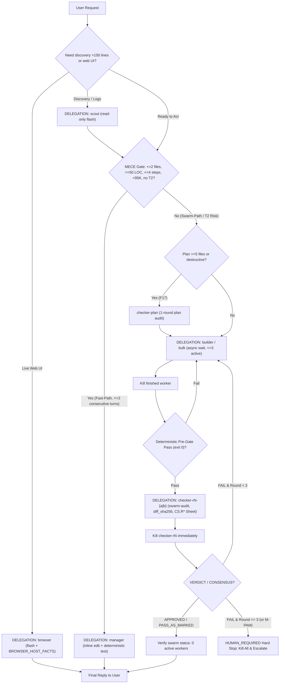

# Antigravity Delegation Rules (`v1.3`)

Standalone, portable delegation rules, skill playbooks, and optional runtime hooks for **Antigravity** native agent sessions (`swarm` / `invoke_subagent`).

## Features

- **Family Quota Conservation**: Models use weighted family quota pools (Gemini pool vs Claude pool). Conserves quota via MCP code-graph first, `scout` for `>150`-line discovery, `<= 3` active workers cap, and **Quota-Only `SINGLE_CHECKER_DEGRADED` Fallback** (in Dual-Checker mode, if 1 of 2 checker slots hits explicit `429`/`RESOURCE_EXHAUSTED`/`[quota]` or `0%` pre-dispatch quota, QA continues with the surviving slot for that round and discloses it on `CONSENSUS:`).
- **Interactive Single / Dual Checker Installer (`v1.3`)**: Choose **Dual-Checker (Recommended)** or **Single-Checker** interactively or via CLI flags, with curated model selection and persisted state (`<gemini-dir>/config/agy-installer.json`) for seamless `--verify` / `-VerifyOnly`.
- **5+1 Native Roles**: `manager` (Fast-Path), `scout` (read-only discovery), `builder` (single writer), `bulk` (parallel/repetitive), `checker` (independent QA), plus `browser`.
- **MECE Routing Gate & Risk Tiers (`T0`/`T1`/`T2`)**: Fast-Path (`<=2` tightly coupled files, `<=50` LOC, `<=4` tool steps, `<95K` context, no `T2` risk paths) vs. Swarm-Path, plus optional `F17` `checker-plan` for `>= 5` files or destructive migrations.
- **On-Demand `swarm-audit` & MVD 7-Column Comment Sheet**: Enforces deterministic pre-gate, non-mutating LF-normalized `diff_sha256` (`git stash create`, no `git add -N`), bounded reads (`R1<=8`, `R2<=3`, `R3<=2`), row-owner `CS.R<n>.<A|B>.<nn>` Comment Sheet, and machine-checkable `VERDICT:` lines.
- **Policy Invariants**: `F2` (no-exception re-audit + max 2 consecutive Fast-Path edit turns), `F6` (`[REDACTED_LITERAL]` secret isolation), `F15` (same-turn dispatch honesty), `F18` (deterministic counts), Prompt-Injection Defense, and Compaction Continuity.
- **Non-Destructive Marker-Based Install**: Inserts/updates only the `<!-- antigravity-delegation-rules:start -->` ... `<!-- antigravity-delegation-rules:end -->` block inside `~/.gemini/GEMINI.md`, preserving existing custom rules.

## Workflow Overview



## Repository Layout

- `rules/delegation-block.md` — Templated delegation rules block merged into `~/.gemini/GEMINI.md` (rendered `<= 36` lines)
- `skills/swarm-delegation/SKILL.md` — Templated native 4-subagent delegation playbook (`~/.gemini/config/skills/swarm-delegation/SKILL.md`, rendered `<= 115` lines)
- `skills/swarm-audit/SKILL.md` — Bounded-read Swarm-Path QA audit & MVD Comment Sheet (`~/.gemini/config/skills/swarm-audit/SKILL.md`, `<= 85` lines)
- `install.sh` — POSIX/Bash interactive & CLI installer, verifier, dry-run, and uninstaller (LF; supports `AGY_RAW_BASE` and `--with-hooks`)
- `install.ps1` — Windows PowerShell 5.1+ / `pwsh` interactive & CLI installer, verifier, dry-run, and uninstaller (UTF-8 no-BOM; supports `AGY_RAW_BASE` and `-WithHooks`)
- `extras/hooks/` — Opt-in (`v1.2`) pure-Node stdlib `PreToolUse` & `Stop` runtime hooks (`agy-role-classifier.js`, `agy-delegation-gate.js`, `agy-stop-gate.js`, `agy-gate-doctor.mjs`)
- `tests/` — Fixture-driven test suite (`tests/test-hooks.mjs` + `tests/fixtures/`)

## Quick Install

### macOS / Linux (Bash)

Interactive install (prompts via `/dev/tty` even when piped via `curl | bash` if a controlling TTY is attached; otherwise falls back to Dual-Checker defaults):

```bash
curl -fsSL https://raw.githubusercontent.com/ehsandftm/antigravity-delegation-rules/main/install.sh | bash
```

Non-interactive / CI / Explicit flags:

```bash
./install.sh --checker-mode dual --slot-a-model claude-opus-5-5-medium --slot-b-model gemini-4-carbon-medium --non-interactive
./install.sh --checker-mode single --slot-a-model gemini-4-carbon-medium --non-interactive
./install.sh --dry-run --checker-mode dual --non-interactive
./install.sh --verify
./install.sh --uninstall
```

### Windows (PowerShell)

Interactive install:

```powershell
irm https://raw.githubusercontent.com/ehsandftm/antigravity-delegation-rules/main/install.ps1 | iex
```

Local clone install / dry-run / verify / uninstall:

```powershell
.\install.ps1 -CheckerMode dual -SlotAModel claude-opus-5-5-medium -SlotBModel gemini-4-carbon-medium -NonInteractive
.\install.ps1 -CheckerMode single -SlotAModel gemini-4-carbon-medium -NonInteractive
.\install.ps1 -DryRun -CheckerMode dual -NonInteractive
.\install.ps1 -VerifyOnly
.\install.ps1 -Uninstall
```

Both installers support custom targets (`--gemini-dir <path>` / `-GeminiDir <path>`), git refs (`--ref <ref>` / `-Ref <ref>`), and `AGY_RAW_BASE` overrides; store timestamped backups exclusively in `<gemini-dir>/backups/`; persist checker selection in `<gemini-dir>/config/agy-installer.json`; and fail closed if markers or state files are malformed.

## Customization & Notes

- **Opus Quota Hint**: Claude Opus 5.5 (`claude-opus-5-5-medium`) has a smaller quota pool and hits rate limits faster than Gemini Carbon (`gemini-4-carbon-medium`). In **Dual-Checker** mode, if one model hits explicit quota/rate-limit (`429`/`RESOURCE_EXHAUSTED`/`[quota]`), QA automatically continues with the surviving slot (`SINGLE_CHECKER_DEGRADED`, disclosing `slot=<A|B> quota_exhausted` on `CONSENSUS:` and in the final reply). Crashes, timeouts, `diff_sha256` mismatches, and `FAIL` verdicts never trigger degraded fallback, and degraded rounds still count toward the `<= 3`-round cap.
- **Model Selection**: Run `swarm(action="models")` inside an Antigravity session to list available model IDs.
- **Prompt-Enforced by Default (`v1.1`)**: The default install remains 100% pure Markdown/Skill with zero runtime dependencies.
- **Opt-In Runtime Hooks (`v1.2`, `--with-hooks` / `-WithHooks`)**: Pass `--with-hooks` (`install.sh`) or `-WithHooks` (`install.ps1`) to install pure-Node stdlib `PreToolUse` (`agy-delegation-gate.js`) and `Stop` (`agy-stop-gate.js`) hooks into `<gemini-dir>/hooks/` and non-destructively merge `"agy-delegation-gate"` and `"agy-stop-gate"` into `<gemini-dir>/hooks.json` (Requires Node.js >= 18; skips cleanly with a warning if `node` is not in `PATH`). Run `node extras/hooks/agy-gate-doctor.mjs` to self-check.
- **Optional MCP Code-Graph Tip**: If you have an MCP code-graph or symbol-indexing server installed, `scout` and `manager` will prefer those tools before falling back to file reads; otherwise `scout` handles discovery directly.

## License

MIT — see [LICENSE](LICENSE).
