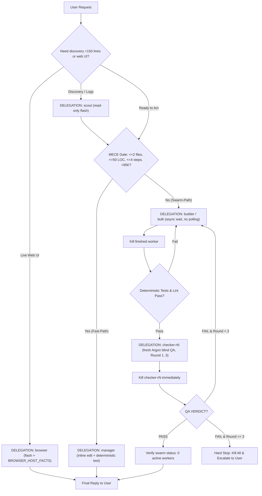

# Antigravity Delegation Rules

Standalone, portable delegation rules and skill playbook for **Antigravity** native agent sessions (`swarm` / `invoke_subagent`).

## Features

- **5+1 Native Roles**: `manager` (Fast-Path), `scout` (read-only discovery), `builder` (single writer), `bulk` (parallel/repetitive), `checker` (independent Argon QA), plus `browser`.
- **MECE Routing Gate**: Fast-Path (`<=2` tightly coupled files, `<=50` LOC, `<=4` tool steps, `<95K` context) vs. Swarm-Path.
- **`DELEGATION:` Triage Header & F15 Honesty**: Mandatory line-1 header on actionable turns; announcing a delegated role requires dispatching it in the same turn.
- **3-Round Fresh Argon QA**: Up to 3 rounds of fresh `checker-rN` (`gemini-4-argon-medium`) before Hard Stop escalation.
- **Non-Destructive Marker-Based Install**: Inserts/updates only the `<!-- antigravity-delegation-rules:start -->` ... `<!-- antigravity-delegation-rules:end -->` block inside `~/.gemini/GEMINI.md`, preserving your existing custom rules.

## Workflow Overview



## Repository Layout

- `rules/delegation-block.md` — Marked delegation rules block merged into `~/.gemini/GEMINI.md`
- `skills/swarm-delegation/SKILL.md` — Native 4-subagent delegation playbook (`~/.gemini/config/skills/swarm-delegation/SKILL.md`)
- `install.sh` — Hardened POSIX/Bash installer, verifier, and uninstaller (LF)
- `install.ps1` — Hardened Windows PowerShell 5.1+ / `pwsh` installer, verifier, and uninstaller

## Quick Install

### macOS / Linux (Bash)

```bash
curl -fsSL https://raw.githubusercontent.com/ehsandftm/antigravity-delegation-rules/main/install.sh | bash
```

Verify / Uninstall:

```bash
curl -fsSL https://raw.githubusercontent.com/ehsandftm/antigravity-delegation-rules/main/install.sh | bash -s -- --verify
curl -fsSL https://raw.githubusercontent.com/ehsandftm/antigravity-delegation-rules/main/install.sh | bash -s -- --uninstall
```

### Windows (PowerShell)

```powershell
irm https://raw.githubusercontent.com/ehsandftm/antigravity-delegation-rules/main/install.ps1 | iex
```

Local clone install / verify / uninstall:

```powershell
.\install.ps1
.\install.ps1 -VerifyOnly
.\install.ps1 -Uninstall
```

Both installers support custom targets (`--gemini-dir <path>` / `-GeminiDir <path>`) and git refs (`--ref <ref>` / `-Ref <ref>`), store timestamped backups exclusively in `<gemini-dir>/backups/`, and fail closed if existing markers in `GEMINI.md` are malformed.

## Customization & Notes

- **Model Selection**: Default worker models (`gemini-4-hydrogen-medium`, `gemini-3.8-flash-medium`, `gemini-4-argon-medium`) can be customized to match your environment. Run `swarm(action="models")` inside an Antigravity session to list available model IDs.
- **Prompt-Enforced (No Hooks)**: Delegation rules are enforced via `GEMINI.md` instructions, `EnableWriteTools: false` isolation on `scout`, and MECE thresholds rather than `hooks.json`, because Antigravity hook payloads do not carry reliable caller-role attribution (`Manager` vs. worker).
- **Optional MCP Code-Graph Tip**: If you have an MCP code-graph or symbol-indexing server installed, `scout` and `manager` will prefer those tools before falling back to file reads; otherwise `scout` handles discovery directly.

## License

MIT — see [LICENSE](LICENSE).
